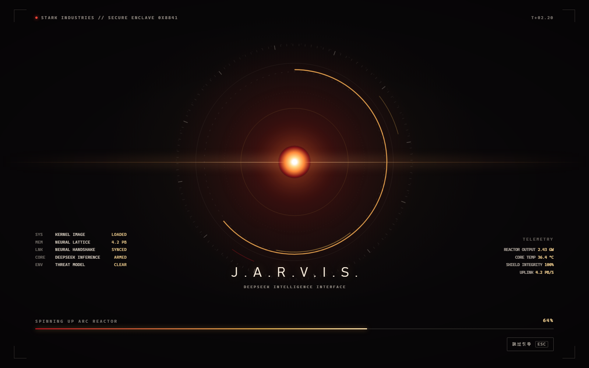
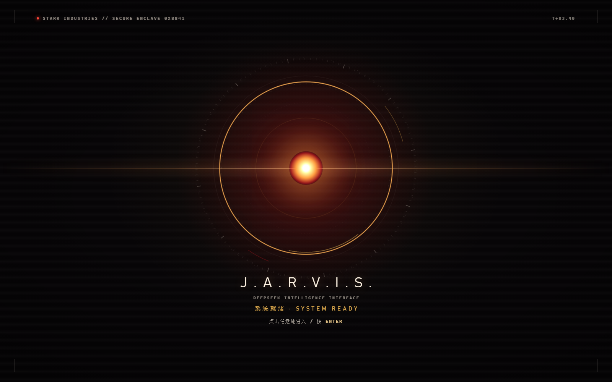

# dsh-jarvis-boot

贾维斯风格的 DSH 开机动画。全屏方舟反应堆 HUD：环系生长 → 启动日志逐行打出 → 进度条走满 → 停在「系统就绪 / SYSTEM READY」，点一下（或回车）淡出，进主界面。





## 特性

- **3.4 秒完整节拍**：环系旋转、刻度、启动日志、遥测读数、进度条，全部按时间轴推进。
- **不锁界面**：播放中按 `Esc` 直接跳就绪；就绪后点任意处 / `Enter` / 空格进入；播放中也可以点「跳过引导」。
- **零依赖、单文件**：`lib/client.js` 约 20KB，没有构建步骤，没有外部字体或图片。
- **Shadow DOM 隔离**：样式不会漏进宿主，宿主的样式也压不扁 HUD。
- **闸门式转场**：点进主界面时，覆盖层从中间一分为二向上下滑出，接缝带一条金色发光线。
- **内置皮肤**：附带 `jarvis` 主题（暖黑底、金强调、红主按钮），在「设置 → 通用 → 外观」里选上就是同一套味道。
- **可关**：`window.__JARVIS_BOOT_DISABLED__ = true` 直接不挂载；或从 profile 的 `bundles` 里删掉本插件。
- **尊重系统偏好**：检测到 `prefers-reduced-motion: reduce` 时直接进就绪态。

## 安装

先确认你有一个可用的 DSH profile（默认 `desktop`）。

### 从 GitHub 装（pnpm）

```bash
cd "$DSH_HOME/profiles/desktop"
pnpm add github:Faustinchain/dsh-jarvis-boot
```

然后把这两处补上：

1. `package.json` 的 `dsh.profile.bundles` 数组里加 `"dsh-jarvis-boot"`；
2. 确认 `cordis.patch.yml` 里有一行 insert（本包自带的 patch 会自动生效，若没生效就手动加）：

```yaml
- insert:
    - id: jarvis-boot
      name: 'dsh-jarvis-boot'
```

重启 DSH，打开 Web GUI 就能看到。

### 本地开发

```powershell
# 把仓库放进 profile 的 node_modules，并按上面的步骤登记
Copy-Item .\lib "C:\Users\<you>\.dsh\profiles\desktop\node_modules\dsh-jarvis-boot\lib" -Recurse
```

改完 `lib/client.js` 后重启 DSH 生效。

## 内置皮肤

插件启动时会向宿主的主题服务注册一个叫 `jarvis` 的主题（`ctx.theme.register`），覆盖约 80 个 `--dsw-*` 语义 token：暖黑底、金色强调、红色主按钮、金描边、暗红气泡。

启用方式：**设置 → 通用 → 外观**，在选择器里选 `jarvis`。选完会持久化到当前浏览器，下次直接生效。

不需要皮肤就继续用 `dark` / `system`，插件不会强行改你的主题。

## 调试入口

页面里有一个调试对象：

```js
window.__JARVIS_BOOT__.seek(1800);  // 跳到第 1.8 秒
window.__JARVIS_BOOT__.skip();      // 直接进就绪
window.__JARVIS_BOOT__.dismiss();   // 立刻关掉覆盖层
window.__JARVIS_BOOT_DISABLED__ = true; // 下次加载不再播放
```

## 工作方式

宿主（`@deepseek-ai/dsh-client-modules`）会把 profile 里每个插件的 client bundle 合成一个 combo 下发。本包做了三件事：

1. `package.json` 用 `dsh.client` 声明这是 web 端插件，`exports["./client"]` 指向构建好的 `lib/client.js`；
2. `lib/client.js` 调 `window.__ModuleLoader__.load({ id, factory })` 注册 `apply(ctx)` / `inject`，`apply` 里用 `ctx.effect(() => mount())` 挂载覆盖层并返回卸载函数；
3. `cordis.patch.yml` 把插件 insert 进 profile 的 loader。

`inject` 为空——不需要任何插槽、路由或服务，挂载完全靠客户端自己。

## 仓库结构

```
lib/client.js      浏览器端：HUD、时间轴、交互（全部逻辑都在这里）
lib/index.js       Node 侧：空插件，只为满足 loader
cordis.patch.yml   profile 挂载行
test/preview.html  离线预览器：stub 掉 ModuleLoader 直接跑 client.js
test/shot.mjs      CDP 截图脚本（配合 headless Edge）
docs/              README 截图
```

## 已知限制

- 每次**页面载入**都会播一次（不是每次应用启动一次）；如果你想「每次启动只播一次」，需要在 client 里加一层 sessionStorage 判断。
- 播放期间是全屏覆盖，和别的开机动画插件同时启用会互相抢屏幕——建议只留一个。

## License

MIT
